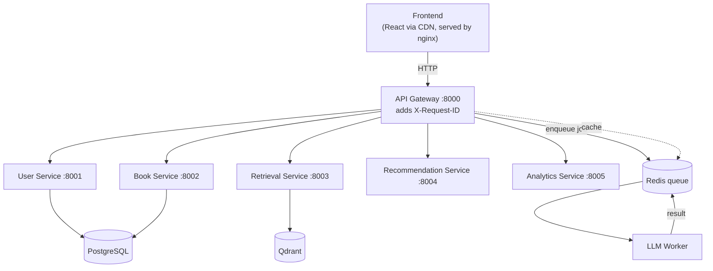

# BookWise AI

[](https://github.com/sisyphus19/bookwiseAI/actions/workflows/ci-cd.yml)


A microservice-based **book recommendation platform**. A natural-language query is embedded, matched against a vector index of books, re-ranked with a multi-factor scoring model, and then explained by an LLM worker running off a Redis queue. If the LLM is slow or unavailable, template explanations are returned instead of failing the request.

## Features

- **Semantic retrieval**: books are embedded with `all-MiniLM-L6-v2` (384-d) and searched in Qdrant. Without Qdrant it falls back to an in-memory vector store.
- **Hybrid re-ranking**: candidate filter → feature extraction → weighted scoring → ranking (see [Scoring](#-scoring)).
- **Async LLM explanations**: jobs go through a Redis list (`llm_explanation_jobs`) to a separate worker. Providers: `local` (template text, no LLM), `openai`, `ollama`.
- **Graceful degradation**: on LLM timeout or failure, the gateway returns template explanations rather than an error.
- **Redis, two roles**: task queue and response/profile cache.
- **JWT auth** with register, login, preferences and a feedback endpoint.
- **Observability basics**: `X-Request-ID` generated at the gateway and forwarded to downstream services, structured logging, `/health`, `/health/live` and Prometheus `/metrics` on every service.
- **Versioned API** under `/api/v1/`.
- **Deployment manifests**: Kubernetes YAML, a Helm chart and an ArgoCD application (see [Status](#-status--known-limitations)).
- **CI**: GitHub Actions runs tests, builds the image, and lints/templates the Helm chart.

## Architecture



**Request flow for `POST /api/v1/recommend`:**

1. Gateway calls Retrieval Service → top-20 candidates from Qdrant.
2. Gateway calls Recommendation Service → candidates re-ranked.
3. Gateway enqueues an explanation job in Redis; the LLM Worker generates explanations.
4. Gateway waits for the worker's result, or falls back to template explanations on timeout.

More detail in [`docs/`](docs/): [Architecture](docs/Architecture.md) · [Design Decisions](docs/DesignDecisions.md) · [Deployment](docs/Deployment.md) · [Scaling](docs/Scaling.md) · [Failure Scenarios](docs/FailureScenarios.md)

## Tech Stack

| Layer | Tech |
|---|---|
| API | FastAPI, Pydantic v2, Uvicorn |
| Data | PostgreSQL 15 (SQLite fallback for local runs), SQLAlchemy |
| Vector search | Qdrant, sentence-transformers |
| Queue / cache | Redis 7 |
| LLM | OpenAI, Ollama, or local template provider |
| Auth | JWT (PyJWT), bcrypt |
| Infra | Docker Compose, Kubernetes, Helm, ArgoCD, GitHub Actions |
| Frontend | React + Tailwind (CDN), nginx |

## Quickstart

The dataset (`data/raw/Books.csv`, 10,000 books) is included. By default the ETL loads the first 1,000 (`DEV_LIMIT` in `etl.py`; set to `None` for all).

### Option A: Full stack with Docker Compose

```bash
git clone https://github.com/sisyphus19/bookwiseAI.git
cd bookwiseAI
cp .env.example .env            # optional: set LLM_PROVIDER / OPENAI_API_KEY

docker compose up --build -d

# Load the catalog into PostgreSQL + Qdrant (run once)
docker compose exec api-gateway python etl.py
```

| What | URL |
|---|---|
| Frontend | http://localhost:3000 |
| API Gateway | http://localhost:8000 |
| Qdrant dashboard | http://localhost:6333/dashboard |

Try it:

```bash
curl -X POST http://localhost:8000/api/v1/recommend \
  -H "Content-Type: application/json" \
  -d '{"query": "books by Suzanne Collins", "top_k": 5}'
```

### Option B: Single process (SQLite + in-memory vectors, no Docker)

```bash
git clone https://github.com/sisyphus19/bookwiseAI.git
cd bookwiseAI
python -m venv .venv && source .venv/bin/activate   # Windows: .venv\Scripts\activate
pip install -r requirements.txt

python etl.py          # builds bookwise_local.db and the in-memory index
python main.py         # monolith; interactive docs at http://localhost:8000/docs
```

## API

All routes are under `/api/v1`. The monolith (`main.py`) exposes everything; in the microservice stack the routes are split across services behind the gateway.

| Method | Route | Purpose |
|---|---|---|
| POST | `/users/register` | Create account |
| POST | `/users/login` | Get JWT |
| GET | `/users/me` | Current user |
| PUT | `/users/preferences` | Update genres / preferences |
| GET | `/books` | List books |
| GET | `/books/{book_id}` | Book detail |
| POST | `/recommend` | Query → ranked, explained recommendations |
| POST | `/feedback` | Submit feedback on a recommendation |
| GET | `/health`, `/health/live`, `/metrics` | Ops endpoints (no prefix) |

## Scoring

```
FinalScore = 0.45 · Semantic + 0.25 · GenreAffinity + 0.15 · Popularity + 0.15 · Recency
```

Weights are defined in `core/recommendation_engine.py`; the rationale is in [Design Decisions](docs/DesignDecisions.md).

## Configuration

Copy `.env.example` to `.env`. Key variables:

| Variable | Default | Notes |
|---|---|---|
| `LLM_PROVIDER` | `local` | `local`, `openai` or `ollama` |
| `OPENAI_API_KEY` | – | required for `openai` |
| `OPENAI_MODEL` | `gpt-4o-mini` | |
| `LLM_TIMEOUT_SECONDS` | `20` | per-call LLM timeout |
| `DATABASE_URL` | see `.env.example` | only needed for host runs against Compose |
| `QDRANT_HOST` / `QDRANT_PORT` | `localhost` / `6333` | |
| `REDIS_URL` | `redis://localhost:6379/0` | |

> ⚠️ `docker-compose.yml` ships demo credentials (Postgres password, `SECRET_KEY`). Change them before exposing anything outside your machine.

## Testing

```bash
pytest tests/ -v
```

`tests/test_phase1.py` covers the API and ETL. `tests/test_rag_pipeline.py` covers retrieval, ranking and the LLM worker. To measure a **running** stack (retrieval hit-rate and latency over a small set of title/author queries):

```bash
python scripts/eval_pipeline.py --base http://localhost:8000 --k 5 --out docs/eval_results.md
```

## Project Structure

```
├── api-gateway/            # orchestrates retrieval → ranking → LLM job
├── user-service/           # auth, preferences
├── book-service/           # catalog
├── retrieval-service/      # Qdrant vector search
├── recommendation-service/ # feature extraction + scoring
├── analytics-service/      # event tracking
├── llm_worker/             # Redis queue consumer, generates explanations
├── core/                   # DB models, vector store, ranking engine, LLM providers, cache, auth
├── shared/                 # config, logging, schemas
├── frontend/               # single-page dashboard
├── infra/                  # k8s manifests + Helm chart
├── gitops/                 # ArgoCD app + per-environment values
├── scripts/                # evaluation pipeline
├── tests/
├── data/raw/Books.csv
├── etl.py                  # loads CSV → DB + vector index
└── main.py                 # monolith entrypoint (local mode)
```

## Status & Known Limitations

- The catalog is **metadata-only** (title, author, year, rating), so semantic matching works best for title/author-style queries rather than plot or mood queries.
- With `LLM_PROVIDER=local` explanations are templated from metadata, not generated by a model.
- Kubernetes/Helm/ArgoCD manifests are included and linted in CI, but have not been verified against a live cluster. Each service image currently shares one Dockerfile whose default command is the monolith, so per-service `command`s need to be set in the manifests (Compose already does this).
- Latency and scaling figures in `docs/` are design targets unless an eval report is checked in.

## Roadmap

- Richer catalog (descriptions, genres) for better semantic retrieval
- Per-service images and manifest commands
- Rate limiting and circuit breakers at the gateway
- Run the full test suite in CI

## Author

**Atharv**, [@sisyphus19](https://github.com/sisyphus19)
